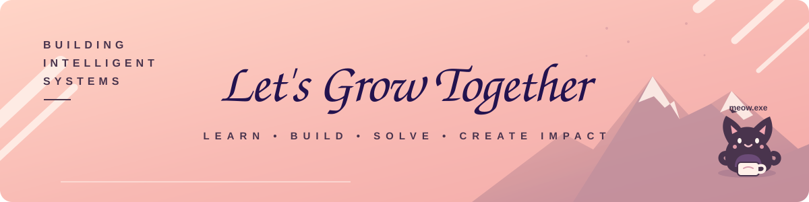
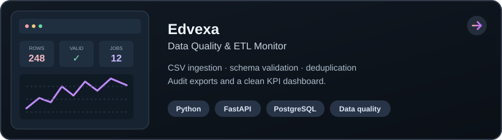
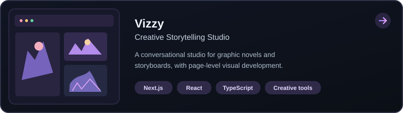
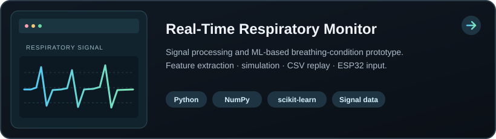
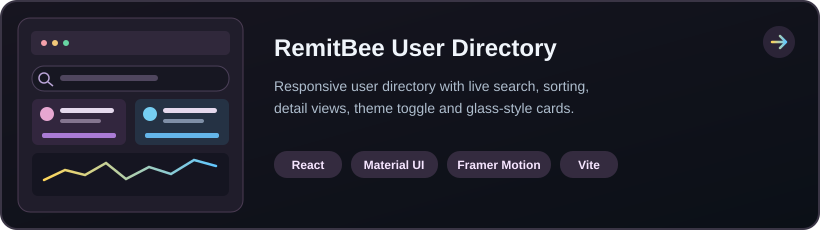
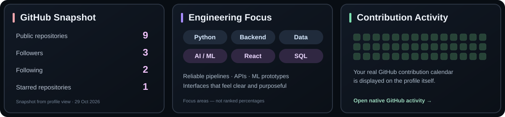

 

# Hey, I'm Raghav Kumar 👋

### Software Engineer · AI/ML · Backend & Data Systems

Building useful products with **code, data, and AI** — from backend APIs and data pipelines to creative tools and applied ML.

---

## 🧭 About Me

<table>
<tr>
<td width="68%" valign="top">

I'm a Computer Science and Engineering student in the **AI specialization track at Vel Tech, Chennai (YOP 2026)**. I enjoy solving real-world problems with reliable software — from data pipelines and APIs to AI-powered tools and thoughtful user experiences.

- 🛠️ **Building:** Python services, data-quality workflows, dashboards, and AI-enabled products
- 🌱 **Startup experience:** Led work on **Greensort.in**, a student-led plant-selection and e-commerce initiative featuring AI-driven recommendations
- 🧠 **Exploring:** Applied machine learning, intelligent tools, and better developer experiences
- 🤝 **Interested in:** Software Engineering, Backend Engineering, Data Engineering, and AI/ML roles

</td>
<td width="32%" valign="middle" align="center">

> **“Turning ideas into useful products with code, data, and AI.”**

 

</td>
</tr>
</table>

## ⚙️ Tech Stack

  
  
  

## 🚀 Featured Projects

  
  

  
  

## 📊 GitHub Stats & Activity

<a href="https://github.com/renavaraghav">Open GitHub profile for the live contribution calendar →</a>

---

*“Consistent learning today. Bigger possibilities tomorrow.”*

**Thanks for visiting my profile!** ✨

